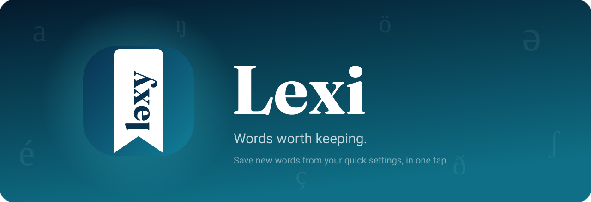
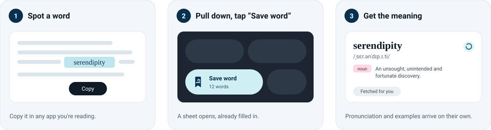
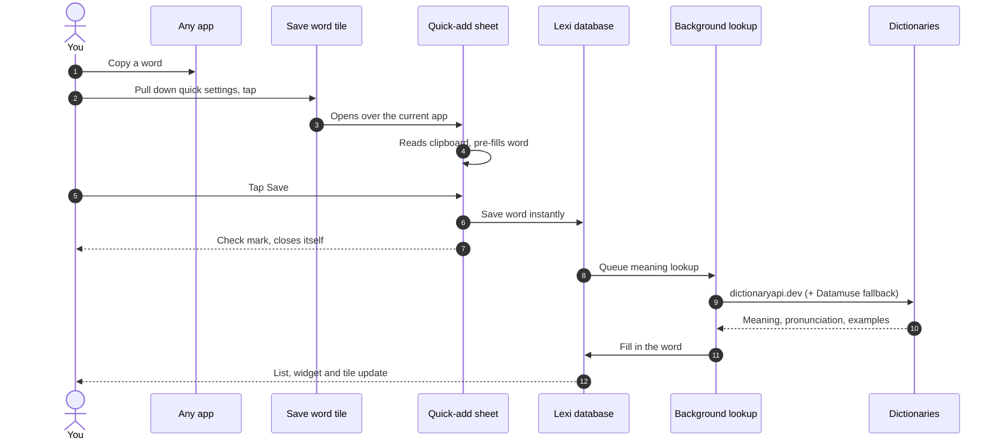
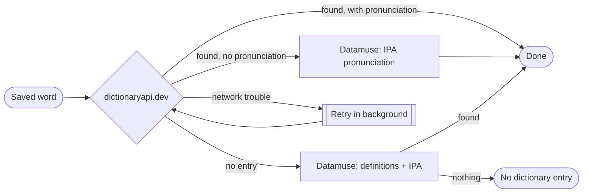
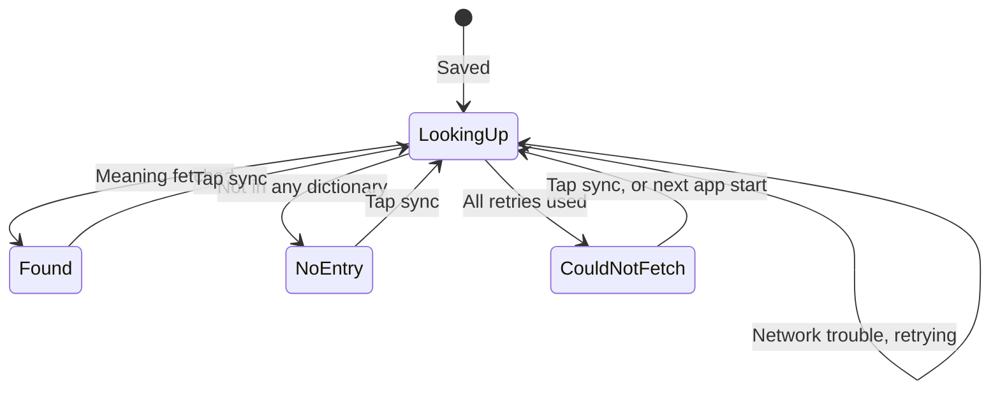
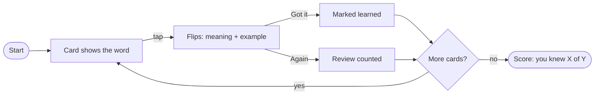
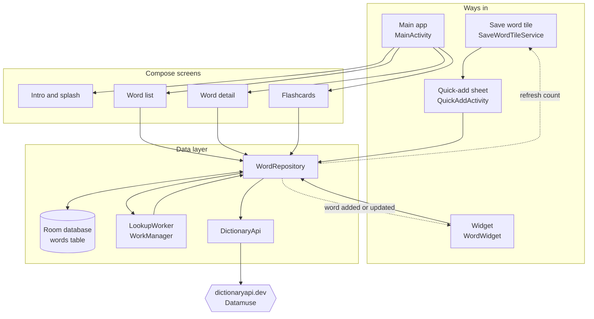

<p align="center">
  
</p>

<p align="center">
  <b>An Android app for collecting new words the moment you find them.</b><br>
  Copy a word anywhere, pull down your quick settings, tap <b>Save word</b>. Lexi does the rest.
</p>

<p align="center">
  
  
  
  
</p>

---

## Contents

- [Why Lexi](#why-lexi)
- [How it works](#how-it-works)
- [Features](#features)
  - [Quick Settings tile](#1-quick-settings-tile)
  - [Automatic meanings](#2-automatic-meanings)
  - [Your word list](#3-your-word-list)
  - [Word details](#4-word-details)
  - [Flashcards](#5-flashcards)
  - [Home screen widget](#6-home-screen-widget)
  - [Launch animation](#7-launch-animation)
- [Install](#install)
- [First-time setup](#first-time-setup)
- [Privacy](#privacy)
- [Architecture](#architecture)
- [Project structure](#project-structure)
- [Build from source](#build-from-source)
- [Design](#design)
- [Troubleshooting](#troubleshooting)

---

## Why Lexi

You run into an interesting word while reading an article, a chat or a book. Opening a dictionary,
then a notes app, then remembering to review it later is enough friction that most words are
forgotten by the end of the day.

Lexi cuts that down to one swipe and one tap, from inside whatever app you are already using. The
meaning, pronunciation and examples are fetched for you in the background, and the words come back
later as flashcards and on your home screen.

## How it works

<p align="center">
  
</p>



You never wait on the network. The word is stored the instant you tap Save; everything else
happens afterwards, even if you close the sheet, leave the app or are offline at the time.

## Features

### 1. Quick Settings tile

The heart of the app. Add **Save word** to your quick settings once, and saving a word from any
app becomes: pull down, tap, save.

| What happens | Details |
|---|---|
| Tap the tile | A small sheet slides up **over the app you were using**. Lexi doesn't take over the screen. |
| Clipboard pre-fill | If you just copied a word or short phrase, it's already in the box and selected, so typing replaces it. |
| What counts as a word | Up to 40 characters and 4 words, containing a letter, and not a link. Stray punctuation from copying is trimmed. |
| Save | A haptic tick and a check mark, then the sheet closes on its own. **View word** jumps straight to it. |
| Duplicates | Saving a word you already have says *Already in your collection* instead of creating a copy (case-insensitive). |
| Live count | The tile's subtitle shows how many words you've saved (Android 10+). |
| Locked phone | Tapping the tile asks you to unlock first, then opens the sheet. |

> [!NOTE]
> Android 10 and later only let apps read the clipboard while they're on screen. Lexi reads it the
> moment the sheet appears, so on Android 12+ you'll see a small *"Lexi pasted from your
> clipboard"* notice. That's expected.

### 2. Automatic meanings

Every saved word is looked up for you. Lexi combines two free dictionaries that need no account
or key:



- **dictionaryapi.dev** gives the full entry: every part of speech, up to 5 definitions each,
  example sentences and up to 8 similar words.
- **Datamuse** fills gaps: it supplies the IPA pronunciation when the main dictionary has none
  (for example *effable* → `/ˈɛfʌbʌɫ/`), and definitions for words the main dictionary lacks.

**Built to be reliable.** Lookups run through Android's WorkManager, so they:

- survive the sheet closing, the app being swiped away or the phone restarting,
- **wait for a connection** if you're offline, then run automatically,
- retry each request up to 3 times on timeouts, dropped connections, rate limits and server errors,
  then retry the whole lookup with growing pauses (15 s, 30 s, 1 min, …) up to 6 times,
- open a fresh connection for every request, which avoids stale connections failing after the app
  has been in the background.

A word moves through these states, shown on its card:



Re-syncing never throws away a meaning you already have. If a refresh fails or comes back empty,
the existing meaning stays.

### 3. Your word list

| | |
|---|---|
| **Grouped by time** | Today, Yesterday, This week, This month, Earlier. |
| **Search** | Matches the word or its definition as you type. |
| **Filters** | All, To learn, Learned. |
| **Cards** | Word in serif type, pronunciation, a part-of-speech tag and a two-line definition. A ✓ marks learned words. |
| **Sync a word** | Every card has a ⟳ button that spins while that word is being looked up. |
| **Sync everything** | The ⟳ in the top bar re-fetches every word, handy after an update or a spell offline. |
| **Delete** | Swipe a card left. An **Undo** snackbar brings it back. |
| **While loading** | A soft shimmer stands in for the definition until it arrives. |

### 4. Word details

Tap any word for its full page:

- **Pronounce**: the speaker button reads the word aloud with Android's text-to-speech.
- **Every sense**: grouped by part of speech, numbered definitions with example sentences set as
  quotes, and *Similar* words as chips.
- **My note**: write where you found it, your own definition or a sentence. Saved as you type.
- **Mark learned**, **sync** and **delete** from the same page.
- When no dictionary has the word, the page says so and suggests writing your own meaning in the note.

### 5. Flashcards

Open them from the cards icon in the top bar.



- Cards flip with a 3D turn; a progress bar shows how far through the deck you are.
- The deck is the words you haven't learned yet, shuffled. Switch on **Include learned** to review everything.
- Each word remembers how many times you've reviewed it.

### 6. Home screen widget

A **Lexi word** widget shows a random word from your collection with its pronunciation, part of
speech and meaning. Tap it to open the word, or tap ⟳ for another. It follows your wallpaper
colours, refreshes when you save words, and invites you to save your first word when the
collection is empty.

### 7. Launch animation

Every time you open Lexi, the logo plays a short animation and then opens onto your words.

| Moment | What you see |
|---|---|
| 0 ms | The bookmark drops in from above with a soft bounce and a teal glow. |
| 260 ms | **l · ə · x · y** pop up the bookmark's spine, one letter at a time. |
| 560 ms | **Lexi** springs up below it. |
| 860 ms | *Words worth keeping.* fades in. |
| 1.47 s | A circle opens outward from the logo, revealing your word list as it settles into place. |

- **Tap anywhere** to skip straight to the reveal.
- The **first launch** also shows three how-it-works cards and a **Get started** button; the
  reveal then opens from the button.
- The animation is skipped when you open Lexi to a specific word (from the widget or the
  quick-add sheet), when you return to Lexi while it's still open, and on screen rotation.
- Long-press **Your words** on the home screen to replay the first-launch intro.

## Install

1. Download `app-release.apk` (or [build it yourself](#build-from-source)).
2. Open it on your phone. Android will ask to allow installs from that source; allow it once.
3. Open **Lexi**.

Lexi needs Android 8.0 or newer. Android 12+ gets wallpaper-matched colours.

## First-time setup

**Add the tile.** This is the one step that makes Lexi useful.

- **Android 13 and newer:** tap **Add tile** on the banner at the top of your word list, then
  confirm. Done.
- **Older versions:**
  1. Swipe down twice from the top of the screen.
  2. Tap the pencil (edit) icon.
  3. Drag **Save word** into your active tiles. Placing it in the first row makes it reachable with one swipe.

**Optional: add the widget.** Long-press your home screen, choose **Widgets**, find **Lexi** and
drag **Lexi word** onto the screen.

## Privacy

- **No account, no sign-in, no tracking, no ads.**
- Your words, notes and progress are stored **only on your phone**, in Lexi's private database.
- The only data that leaves your phone is **the word itself**, sent to
  [dictionaryapi.dev](https://dictionaryapi.dev) and [Datamuse](https://www.datamuse.com/api/)
  to fetch its meaning.
- The clipboard is read only while the save sheet is open on screen, and only to pre-fill the box.
- The only permission Lexi asks for is internet access.

## Architecture



- **One source of truth.** Every screen observes the Room database through Kotlin `Flow`, so a
  meaning that arrives in the background appears on the list, the detail page and the widget at
  the same moment.
- **Simple dependency setup.** `AppContainer` in `LexiApp.kt` builds the database, API client
  and repository once; there's no DI framework to learn.
- **Save first, enrich later.** `WordRepository.save()` inserts the word and returns
  immediately; `LookupWorker` does the network work with a connection requirement and
  exponential backoff.
- **Side effects in one place.** After any change, the repository refreshes the widget and asks
  the tile to update its word count.

### Data model

Each saved word is one row in the `words` table:

| Field | Meaning |
|---|---|
| `word` | Lowercased, trimmed form, unique. Used to catch duplicates. |
| `display` | The word as you typed or copied it. |
| `phonetic` | IPA pronunciation, e.g. `/ˌsɛr.ənˈdɪp.ɪ.ti/`. |
| `partOfSpeech`, `definition`, `example` | The first sense, used on cards, flashcards and the widget. |
| `sensesJson` | Every sense, definition, example and synonym, for the detail page. |
| `note` | Your own note. |
| `createdAt` | When you saved it; drives the Today / This week grouping. |
| `learned`, `reviewCount` | Flashcard progress. |
| `lookupState` | `PENDING`, `FOUND`, `NOT_FOUND` or `FAILED`. |

## Project structure

```text
app/src/main/
├── AndroidManifest.xml            tile service, activities, widget receiver
├── java/com/tonmoy/lexi/
│   ├── LexiApp.kt                 Application + AppContainer (manual DI)
│   ├── data/
│   │   ├── WordEntity.kt          Room entity, senses model
│   │   ├── WordDao.kt             queries (observe, search, random, pending)
│   │   ├── LexiDatabase.kt
│   │   ├── DictionaryApi.kt       dictionaryapi.dev + Datamuse, retries
│   │   ├── LookupWorker.kt        WorkManager job, network constraint, backoff
│   │   └── WordRepository.kt      save, lookup, resync, notes, reviews
│   ├── tile/
│   │   └── SaveWordTileService.kt Quick Settings tile
│   ├── quickadd/
│   │   └── QuickAddActivity.kt    translucent save sheet, clipboard pre-fill
│   ├── ui/
│   │   ├── MainActivity.kt        navigation, launch animation hand-off
│   │   ├── intro/                 IntroScreen (splash + first-run), SpineMark logo
│   │   ├── home/                  word list, tile banner, sync button
│   │   ├── detail/                word page, text-to-speech, notes
│   │   ├── flashcards/            flip cards and review session
│   │   └── theme/                 colours, type, shapes
│   └── widget/
│       └── WordWidget.kt          Glance home screen widget
└── res/
    ├── drawable/                  launcher, themed and tile icons (vector)
    ├── values-v31/                Android 12+ launch screen
    └── xml/word_widget_info.xml
```

## Build from source

**Requirements:** JDK 17 and the Android SDK with platform 35.

```bash
# macOS, with Homebrew
brew install openjdk@17
brew install --cask android-commandlinetools
yes | sdkmanager --licenses
sdkmanager "platforms;android-35" "build-tools;35.0.0" "platform-tools"
```

Tell Gradle where the SDK is by creating `local.properties` in the project root:

```properties
sdk.dir=/opt/homebrew/share/android-commandlinetools
```

Then build:

```bash
export JAVA_HOME=/opt/homebrew/opt/openjdk@17/libexec/openjdk.jdk/Contents/Home
./gradlew assembleRelease
```

The APK is written to `app/build/outputs/apk/release/app-release.apk`. Install it over USB with
`adb install -r app/build/outputs/apk/release/app-release.apk`, or copy it to the phone.

> [!IMPORTANT]
> The release build is signed with the debug key so it installs without any setup. Sign it with
> your own keystore before publishing it anywhere. Keep using the same key for updates, or Android
> will refuse to install over the existing app and you'd have to uninstall (losing your words).

**Tech stack**

| Area | Library |
|---|---|
| Language | Kotlin 2.0, coroutines and Flow |
| UI | Jetpack Compose, Material 3, Material You dynamic colour |
| Navigation | Navigation Compose |
| Storage | Room |
| Background work | WorkManager |
| Widget | Jetpack Glance |
| Networking | `HttpURLConnection` + kotlinx.serialization (no extra HTTP library) |
| Min / target SDK | 26 / 35 |

## Design


**The logo, "Spine".** A ribbon bookmark, because the app is about *saving* words, with
**ləxy** running up it like the title on a book's spine. *ləxy* is Lexi spelled the way a
dictionary writes pronunciation: the **ə** (schwa) is the most common sound in English and the
symbol every pronunciation guide uses. The lettering is Fraunces Bold, converted to vector
outlines so it renders crisply at every size. At Quick Settings size, where four letters can't be
read, the tile shows the bookmark with just **lə**.

**Colour.** Deep navy `#08304F` to teal `#11809A` for the icon, and `#041A2C` to `#0E6F86` for
the launch screen. Inside the app, Android 12+ phones use colours drawn from your wallpaper.

**Type.** Words are always set in a serif face so they read like dictionary entries, against a
clean sans-serif interface.

**Motion.** Springs rather than fixed curves, so movement settles naturally. All animation runs in
the draw phase, so the screen is redrawn without rebuilding the layout, which keeps it smooth on
mid-range phones. The Android 12+ system launch screen is set to the intro's first colour with no
icon, so opening the app never flashes white or shows the logo twice.

## Troubleshooting

<details>
<summary><b>I can't find the Save word tile</b></summary>

Open quick settings, tap the pencil (edit) icon and look in the inactive tiles for **Save word**
with the bookmark icon. Some phones (MIUI/HyperOS, One UI) place it on a second page of the editor.
</details>

<details>
<summary><b>The sheet opens empty even though I copied a word</b></summary>

Lexi only pre-fills text that looks like a word or short phrase: up to 40 characters and 4 words,
with at least one letter, and not a link. A whole sentence or URL is ignored on purpose. You can
still type or paste it.
</details>

<details>
<summary><b>A word is stuck on "looking up" or says it couldn't fetch the meaning</b></summary>

Lookups wait for a connection and retry on their own. To retry immediately, tap the ⟳ on that
word's card, or the ⟳ in the top bar to refresh every word.
</details>

<details>
<summary><b>A word has no pronunciation</b></summary>

Neither dictionary has IPA for that word. Tap ⟳ later; you can also use the speaker button on the
word's page, which works for any word.
</details>

<details>
<summary><b>"No dictionary entry"</b></summary>

The word isn't in either dictionary (slang, names, very new words). Add your own meaning in
**My note**; it then shows on the card and on flashcards.
</details>

<details>
<summary><b>I want to see the intro again</b></summary>

Long-press **Your words** at the top of the word list.
</details>
